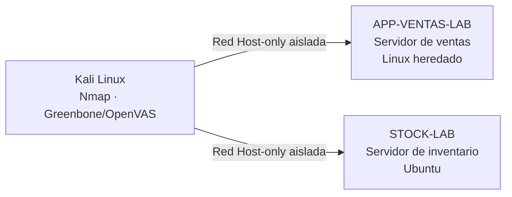

# 🔍 Análisis de Vulnerabilidades y Mitigación: Nmap + Greenbone/OpenVAS

[](https://www.kali.org/)
[](https://nmap.org/)
[](https://www.openvas.org/)
[](https://www.first.org/cvss/)
[](./LICENSE)
[]()

> Evaluación de vulnerabilidades de punta a punta sobre dos servidores de laboratorio que simulan los sistemas de **ventas** e **inventario** de una distribuidora: reconocimiento, escaneo automatizado, valoración de criticidad, **mitigación** y **escaneo de seguimiento** para medir el antes y el después.

> 🔒 El caso de estudio se basa en una empresa real. Aquí se la llama **"la distribuidora"** y todas las direcciones IP son genéricas. **Todas las pruebas se hicieron sobre máquinas virtuales aisladas, nunca sobre sistemas de la empresa.**

---

## 📋 Tabla de contenidos

- [Escenario](#-escenario)
- [Metodología](#-metodología)
- [Hallazgos](#-hallazgos)
- [Mitigaciones aplicadas](#️-mitigaciones-aplicadas)
- [Antes vs. después](#-antes-vs-después)
- [Estructura del repositorio](#-estructura-del-repositorio)
- [Aprendizajes](#-aprendizajes)
- [Autora](#-autora)

---

## 🎯 Escenario



| Activo | Rol simulado | Superficie inicial |
|---|---|---|
| **APP-VENTAS-LAB** | Aplicación de ventas | Decenas de servicios expuestos, sistema operativo sin soporte |
| **STOCK-LAB** | Gestión de inventario | Solo SSH (22/tcp) |

---

## 🧭 Metodología

1. **Reconocimiento con Nmap:** barrido de todos los puertos TCP (`-sV -p-`) y verificación dirigida con scripts NSE (`ftp-anon`, `http-headers`, `smb-protocols`, `smb-security-mode`, `nfs-showmount`, `nfs-ls`, `ssh2-enum-algos`, `ssh-auth-methods`).
2. **Escaneo automatizado con Greenbone/OpenVAS:** perfil *Full and fast*, todos los puertos TCP más el top 100 UDP, máximo 4 NVT simultáneos por host y filtro **QoD ≥ 70 %**.
3. **Valoración de criticidad** con dos criterios:
   - Severidad **CVSS** del escáner cuando el QoD era ≥ 70 %.
   - Una **matriz Probabilidad × Impacto (1–3)** para las configuraciones que confirmé con Nmap:

| P \ I | Bajo (1) | Medio (2) | Alto (3) |
|---|---|---|---|
| **Alta (3)** | Media (3) | Alta (6) | Crítica (9) |
| **Media (2)** | Baja (2) | Media (4) | Alta (6) |
| **Baja (1)** | Baja (1) | Baja (2) | Media (3) |

4. **Mitigación** de las vulnerabilidades críticas con controles reversibles y de bajo costo.
5. **Escaneo de seguimiento** con los mismos parámetros, para comparar.

> No atribuí CVE ni puntajes CVSS a un hallazgo sin evidencia suficiente. Las configuraciones inseguras se reportan como tales.

---

## 🚨 Hallazgos

**Escaneo inicial de APP-VENTAS-LAB: 71 hallazgos** (14 críticos · 10 altos · 41 medios · 6 bajos).
**STOCK-LAB: 3 hallazgos bajos** (TCP Timestamps, ICMP Timestamp y MAC de 64 bits en SSH).

| Hallazgo | Puerto | Criticidad | Método |
|---|---|---|---|
| Puerta trasera **Ingreslock** (shell root sin autenticación) | 1524/tcp | 🔴 Crítica 10.0 | OpenVAS (QoD 99 %) |
| **dRuby/DRb** RCE corriendo como root | 8787/tcp | 🔴 Crítica 10.0 | OpenVAS (QoD 99 %) |
| **Tomcat** con credenciales por defecto | 8180/tcp | 🔴 Crítica 10.0 | OpenVAS (QoD 98 %) |
| Servicios heredados **rexec / rlogin / rsh** | 512–514/tcp | 🔴 Crítica 10.0 | OpenVAS + Nmap |
| **TWiki** obsoleto (XSS y ejecución de comandos) | 80/tcp | 🔴 Crítica 10.0 | OpenVAS |
| Sistema operativo **fuera de soporte** | general | 🔴 Crítica 10.0 | OpenVAS |
| **Telnet** sin cifrado | 23/tcp | 🟠 Alta (P2×I3 = 6) | Nmap + conexión manual |
| **NFS** exportando `/` a cualquier cliente | 2049/tcp | 🟠 Alta (P3×I2 = 6) | Nmap `nfs-showmount`/`nfs-ls` |
| **FTP anónimo** habilitado | 21/tcp | 🟡 Media (P3×I1 = 3) | Nmap + login `anonymous` |
| **SMBv1** con firma deshabilitada | 139, 445/tcp | 🟡 Media (P2×I2 = 4) | Nmap NSE |
| Cabeceras HTTP que revelan versiones (Apache 2.2.8, PHP 5.2.4) | 80/tcp | 🟢 Baja (P2×I1 = 2) | Nmap `http-headers` |

---

## 🛠️ Mitigaciones aplicadas

Elegí las **cuatro vulnerabilidades críticas** que daban ejecución remota con más facilidad y les apliqué controles de bajo costo:

| # | Vulnerabilidad | Medida | Verificación |
|---|---|---|---|
| 1 | Ingreslock (1524/tcp) | Comenté la entrada en `/etc/inetd.conf` y reinicié `xinetd` | Nmap: puerto **closed** |
| 2 | rexec (512/tcp) | Comenté la entrada `exec` en `/etc/inetd.conf` | `netstat` sin proceso escuchando + Nmap **closed** |
| 3 | dRuby (8787/tcp) | Comenté el arranque en `/etc/rc.local` y detuve el proceso | Nmap **closed** |
| 4 | Tomcat (8180/tcp) | Respaldé `tomcat-users.xml`, cambié las 3 contraseñas, validé el XML y reinicié | `tomcat:tomcat` → **HTTP 401** |

📄 Los comandos y fragmentos de configuración están en [`mitigaciones/`](./mitigaciones).

### Costo/beneficio
Las cuatro medidas tienen **costo bajo** (cambios de configuración, sin licencias) y eliminan las vías de RCE de mayor severidad. Ninguna reemplaza la **medida de fondo**, que es actualizar o reconstruir el sistema operativo y los componentes obsoletos.

---

## 📊 Antes vs. después

| Severidad | Inicial | Seguimiento | Variación |
|---|---|---|---|
| 🔴 Crítica | 14 | **8** | **−6** |
| 🟠 Alta | 10 | 10 | 0 |
| 🟡 Media | 41 | 40 | −1 |
| 🟢 Baja | 6 | 6 | 0 |
| **Total** | **71** | **64** | **−7 (−9,9 %)** |

Los cuatro hallazgos intervenidos ya **no aparecen** entre los críticos del reporte de seguimiento.

**Riesgo residual (lo reconozco explícitamente):**
- Quedan 8 críticos: sistema operativo sin soporte, TWiki, vsftpd, Tomcat AJP (*Ghostcat*), DistCC, PostgreSQL y VNC.
- rlogin y rsh (513–514) no se intervinieron.
- Deshabilitar Ingreslock no descarta un compromiso previo. Lo recomendado es reconstruir el servidor desde una imagen confiable.

---

## 📁 Estructura del repositorio

```
.
├── README.md
├── LICENSE
├── docs/
│   └── comandos_reconocimiento.md   # Comandos Nmap/NSE usados por hallazgo
└── mitigaciones/
    ├── 01_ingreslock_rexec.md       # inetd.conf + xinetd
    ├── 02_druby.md                  # rc.local + detención del proceso
    └── 03_tomcat_credenciales.md    # tomcat-users.xml
```

---

## 💡 Aprendizajes

- ✅ **CVSS mide la severidad técnica, no el riesgo de negocio.** La priorización final consideró el rol de cada activo en el proceso de ventas o inventario.
- ✅ **Las conclusiones se basan en evidencia.** Un hallazgo pasivo o sin verificar no se presenta como vulnerabilidad confirmada.
- ✅ **Validar cada mitigación en forma individual** (Nmap, HTTP 401), sin confiar solo en que bajó el total del escáner.
- ✅ **Mitigar no es remediar.** Cerrar un puerto reduce la exposición, pero no corrige un sistema obsoleto.

---

## 👩‍💻 Autora

**Catalina Rebolledo Rojas** · [@Cataliniwis](https://github.com/Cataliniwis)

Asignatura *Análisis de Vulnerabilidades* · Técnico en Ciberseguridad
Instituto Profesional San Sebastián · 2026

---

## 📄 Licencia

Este proyecto se distribuye bajo la licencia MIT. Ver [LICENSE](./LICENSE).

---

> ⚠️ **Disclaimer:** trabajo académico realizado solo en un laboratorio aislado y autorizado. El nombre de la empresa del caso de estudio, las direcciones IP y las credenciales fueron omitidos o reemplazados.
